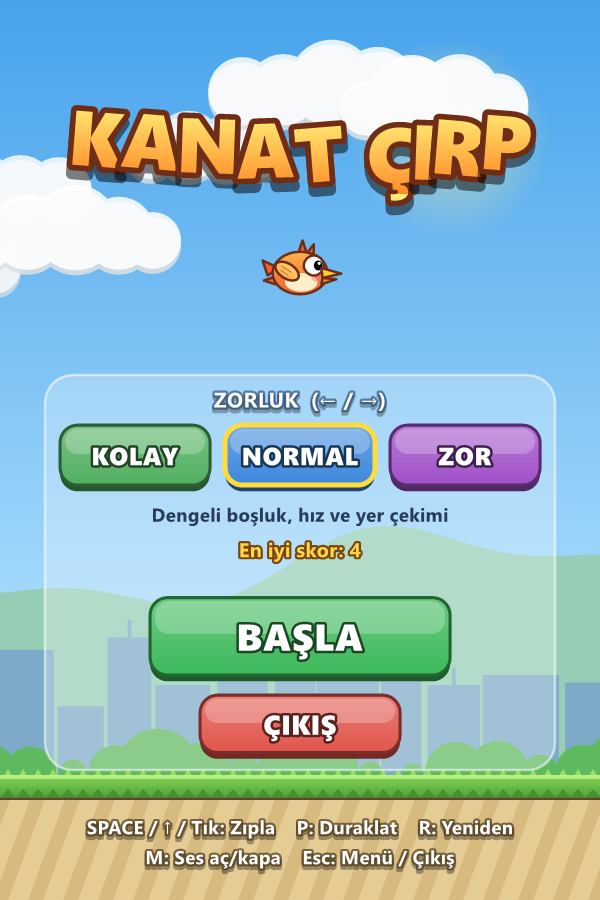
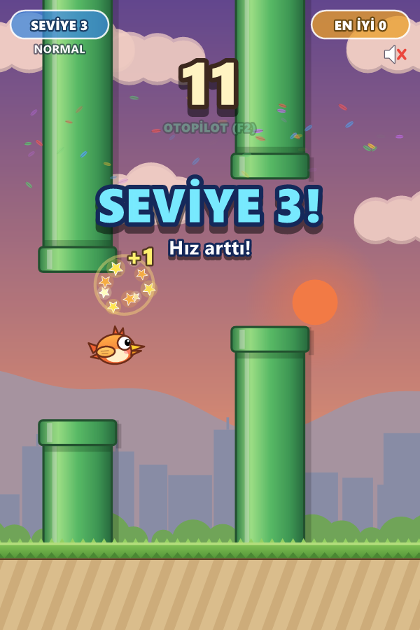
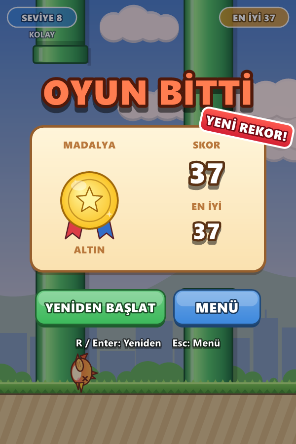

# YMH219 - Flappy Bird Benzeri Oyun: "Kanat Çırp"

Windows Forms ile geliştirilmiş, Flappy Bird tarzı bir masaüstü oyunu. Oyuncu, turuncu tepeli kuşu klavye veya fare ile zıplatarak sağdan sola kayan boruların arasındaki boşluklardan geçirir. Proje; **zamanlayıcı (Timer) ile oyun döngüsü**, **klavye/fare olayları**, **çarpışma kontrolü** ve oyun durumunun **nesne tabanlı** bir yapıyla yönetilmesini göstermek amacıyla hazırlanmıştır.

Tüm grafikler (kuş, borular, gökyüzü, şehir, bulutlar, madalyalar, parçacıklar) **GDI+ ile kodla çizilir**; ses efektleri de program açılırken **matematiksel olarak üretilir**. Projede harici görsel, sprite veya ses dosyası yoktur.

Bu proje, YMH 219 Nesne Tabanlı Programlama dersi ek uygulama ödevlerinin **3. ödevidir**.

## Kullanılan Teknolojiler

| Teknoloji | Açıklama |
|---|---|
| C# | Programlama dili |
| .NET 8 (`net8.0-windows`) | Hedef çatı (`RollForward=Major`) |
| Windows Forms | Pencere, olaylar ve `Timer` |
| GDI+ (`System.Drawing`) | Tüm çizimler: gradyanlar, yollar (GraphicsPath), dönüşümler |
| `System.Media.SoundPlayer` | Kodla üretilen WAV seslerinin çalınması |
| `System.Text.Json` | En yüksek skorların JSON dosyasında saklanması |
| xUnit | Birim testleri (yalnızca test projesinde) |
| Visual Studio 2022 / 2026 | Geliştirme ortamı |

Oyun projesinde **harici NuGet paketi kullanılmamıştır.** Test projesi `xunit`, `xunit.runner.visualstudio` ve `Microsoft.NET.Test.Sdk` paketlerini kullanır.

## Kurulum ve Çalıştırma

### Gereksinimler
- Windows 10 / 11
- [.NET 8 SDK](https://dotnet.microsoft.com/download/dotnet/8.0) veya daha yeni bir SDK
- Visual Studio 2022 (17.8+) veya Visual Studio 2026, **.NET masaüstü geliştirme** iş yüküyle

> Proje `RollForward=Major` ayarına sahiptir. Bilgisayarda .NET 8 çalışma zamanı yoksa daha yeni bir .NET masaüstü çalışma zamanında (ör. .NET 10) da çalışır.

### Visual Studio ile
1. Depoyu klonlayın:
   ```bash
   git clone https://github.com/bakibasbay/YMH219-FlappyBird.git
   ```
2. `YMH219-FlappyBird.sln` dosyasını Visual Studio ile açın.
3. **YMH219-FlappyBird** projesini başlangıç projesi yapın (sağ tık > *Başlangıç Projesi Olarak Ayarla*).
4. **F5** ile çalıştırın.

### Komut satırı ile
```bash
cd YMH219-FlappyBird
dotnet run --project YMH219-FlappyBird
```

Testleri çalıştırmak için:
```bash
dotnet test
```

## Kontroller

| Tuş / Eylem | Görev |
|---|---|
| `Space`, `↑` veya **sol tık** | Zıpla (Hazır ekranında oyunu başlatır) |
| `P` | Duraklat / devam et |
| `R` | Yeniden başlat |
| `Esc` | Menüye dön (menüdeyken çıkış) |
| `M` | Sesi aç / kapat |
| `←` / `→` veya `1` `2` `3` | Menüde zorluk seçimi |
| `Enter` | Menüde başla, oyun bitince yeniden başlat |

## Özellikler

**Föydeki asgari gereksinimler**
- Kuş `Space` / `↑` / tık ile yukarı zıplar, yer çekimiyle aşağı düşer.
- **3 boru çifti** sağdan sola kayar; ekrandan çıkan boru en sağdaki borunun arkasına **rastgele boşluk yüksekliğiyle** yeniden konumlanır.
- Boruya, zemine veya tavana çarpınca oyun durur ve **Game Over** paneli açılır.
- Geçilen her boru **+1 skor** kazandırır.
- **Yeniden Başlat** (buton, `R`, `Enter`) ve **Menü** işlemleri vardır.
- Hız, skor, seviye ve durum bilgileri sınıf özellikleriyle yönetilir (`GameManager.State`, `GameManager.PipeSpeed`, `ScoreManager.Score/Level/HighScore`, `GameSettings`).

**İsteğe bağlı geliştirmeler**
- **En yüksek skor dosyada saklanır** (her zorluk için ayrı): `%AppData%\YMH219-FlappyBird\highscores.json`
- **Seviye sistemi:** her 5 puanda seviye atlanır, borular hızlanır, ekranda "SEVİYE n!" yazısı ve konfeti çıkar.
- **Ses efektleri:** zıplama, skor, çarpma ve seviye atlama sesleri; `M` ile kapatılabilir. Ses çalınamazsa oyun çökmez.
- **Zorluk seviyeleri:** Kolay / Normal / Zor — boru boşluğu, hız, yer çekimi ve boşluklar arası yükseklik farkı değişir.

**Görsel ve oynanış detayları**
- Double-buffered özel `GamePanel` ile titremesiz çizim; ~16 ms `Timer` ve **delta time** ile FPS'ten bağımsız sabit hız.
- **Parallax arka plan:** uzak tepeler, şehir silüeti, çalılar, bulutlar ve zemin farklı hızlarda kayar.
- **Gün döngüsü:** seviye ilerledikçe gökyüzü gündüz → gün batımı → gece → şafak olarak değişir; gece yıldızlar parıldar, ay çıkar, şehirde pencereler yanar.
- **Kuş animasyonu:** kanat çırpma, hıza göre gövde açısı (yükselirken −25°, düşerken +90°'ye kadar yumuşak dönüş), bekleme ekranında sinüsle süzülme, ara sıra göz kırpma.
- **Parçacıklar:** zıplarken toz ve tüy, skor alınca yıldız patlaması ve "+1", çarpışmada patlama ve kopan tüyler; ölünce kısa ekran sarsıntısı ve beyaz flaş.
- **HUD:** konturlu büyük skor (alınınca "pop" animasyonu), seviye ve en yüksek skor kapsülleri.
- **Game Over paneli:** sayarak artan skor, en yüksek skor, "YENİ REKOR!" etiketi ve kodla çizilmiş **bronz (10) / gümüş (20) / altın (30)** madalya.
- Adil oyun için kuşun çarpışma kutusu (hitbox) çizilen gövdeden biraz küçüktür.

## Proje Yapısı ve Sınıf Tasarımı

```
YMH219-FlappyBird/
├── YMH219-FlappyBird.sln
├── README.md
├── screenshots/
├── YMH219-FlappyBird/                 # Oyun projesi
│   ├── Program.cs                     # Giriş noktası
│   ├── Form1.cs                       # Pencere, Timer, girdileri GameManager'a iletir
│   ├── Core/
│   │   ├── GameManager.cs             # Oyun döngüsü ve durum makinesi
│   │   ├── GameState.cs               # Menu / Ready / Playing / Paused / GameOver
│   │   ├── GameSettings.cs            # Zorluğa göre fizik ve hız ayarları
│   │   ├── Difficulty.cs              # Kolay / Normal / Zor
│   │   ├── ScoreManager.cs            # Skor, seviye, en yüksek skor, madalya
│   │   └── Medal.cs                   # Bronz / Gümüş / Altın
│   ├── Entities/
│   │   ├── GameObject.cs              # Soyut temel sınıf
│   │   ├── Bird.cs, Pipe.cs, PipePair.cs, Cloud.cs
│   │   └── Particle.cs, StarParticle.cs, FeatherParticle.cs, RingParticle.cs, TextParticle.cs
│   ├── Rendering/
│   │   ├── GamePanel.cs               # Double-buffered çizim kontrolü
│   │   ├── Background.cs              # Parallax katmanlar ve gün döngüsü
│   │   ├── ParticleSystem.cs          # Parçacıkların yönetimi
│   │   ├── ScreenEffects.cs           # Sarsıntı ve flaş
│   │   ├── Hud.cs, MenuScreen.cs, GameOverPanel.cs, MedalRenderer.cs
│   │   └── UiButton.cs, DrawingHelper.cs
│   └── Services/
│       ├── HighScoreService.cs        # JSON dosyasında en yüksek skor
│       └── SoundService.cs            # Kodla üretilen WAV sesleri
└── YMH219-FlappyBird.Tests/           # xUnit birim testleri
```

| Sınıf | Sorumluluk |
|---|---|
| `GameManager` | Oyunun beyni. `Update(dt)` ve `Draw(g)` ile oyun döngüsünü yürütür; durum makinesini (`State`), boruların yeniden konumlanmasını, skor ve çarpışma kontrolünü yönetir. |
| `GameSettings` | Yer çekimi, zıplama hızı, boru hızı/boşluğu/aralığı gibi ayarlar. `Create(Difficulty)` fabrika metodu zorluğa göre nesne üretir; `GetPipeSpeed(level)` seviyeye göre hızı hesaplar. |
| `ScoreManager` | `Score`, `Level`, `HighScore`, `IsNewRecord` özellikleri; `AddPoint()` seviye atlandığında `true` döner. Madalya eşiklerini bilir. |
| `GameObject` (abstract) | Konum, boyut, `Bounds`; soyut `Update` ve `Draw` metotları. |
| `Bird` | Yer çekimi fiziği, `Jump()`, `Die()`, küçültülmüş `Hitbox`, kanat/açı/süzülme animasyonu. |
| `Pipe` / `PipePair` | Tek boru (gövde + kapak) ve aralarında boşluk olan boru çifti; `Collides(hitbox)` ile dikdörtgen kesişim kontrolü. |
| `Cloud` | Derinliğe göre farklı hızda kayan, rastgele şekilli bulut. |
| `Particle` ve alt sınıfları | Kısa ömürlü efektler. `StarParticle`, `FeatherParticle`, `RingParticle`, `TextParticle` → `Draw`/`Update` metotlarını **override** eder (polimorfizm). |
| `ParticleSystem` | `List<Particle>` üzerinde tek döngüyle tüm türleri günceller/çizer. |
| `Background` | Gökyüzü gradyanı, yıldızlar, güneş/ay ve parallax katmanlar; seviyeye göre gün saati geçişi. |
| `Hud`, `MenuScreen`, `GameOverPanel`, `MedalRenderer`, `UiButton` | Arayüz çizimleri ve butonlar (butonlar `event` ile haber verir). |
| `HighScoreService` | En yüksek skorları JSON dosyasına yazar/okur; tüm dosya işlemleri `try/catch` ile korunur. |
| `SoundService` | Sinüs, kare/üçgen dalga ve gürültüden WAV üretir, `SoundPlayer` ile çalar; hata olursa sessiz devam eder. |
| `Form1` | Yalnızca pencere: `Timer` ile her ~16 ms'de `Update` + `Invalidate`, `KeyDown` ve fare olaylarını `GameManager`'a iletir. |

## Ekran Görüntüleri

### Ana menü (zorluk seçimi, en yüksek skor)


### Oyun sırasında: borular, skor "pop" animasyonu, yıldız parçacıkları ve seviye atlama


### Game Over paneli ve altın madalya


## Testler

`YMH219-FlappyBird.Tests` projesinde 29 birim testi vardır (`dotnet test`):
- Skor artışı, her 5 puanda seviye atlama, rekor güncelleme
- Madalya eşikleri (10 / 20 / 30)
- Zorluk ayarlarının farkı, seviyeye göre hız artışı ve üst sınır
- Kuşun zıplaması, yer çekimi, zeminde durması, hitbox'ın gövdeden küçük olması
- Boru çiftinde boşluk/boru çarpışması ve ekrandan çıkma
- En yüksek skorun dosyaya yazılıp okunması, düşük skorun rekoru ezmemesi, bozuk dosyada çökmeme
- Durum makinesi: Menü → Hazır → Oynanıyor, duraklatma, R ile yeniden başlatma, Esc ile menü (pencere açmadan simülasyon)

## Bilinen Sınırlamalar / Geliştirme Notları

- `System.Windows.Forms.Timer` yaklaşık 15–16 ms çözünürlüğe sahiptir; hareket delta time ile hesaplandığı için hız sabittir ama çok yavaş bilgisayarlarda kare atlamaları görülebilir.
- `SoundPlayer` aynı anda tek ses çalar; art arda gelen sesler birbirini keser (ör. zıplama sesi skor sesini).
- En yüksek skor kullanıcı profilindeki `%AppData%` klasöründe tutulur; başka bir bilgisayarda sıfırdan başlar. Dosya bozulursa skorlar 0 kabul edilir.
- Pencere boyutu ekran ölçeğine göre ayarlanır, yeniden boyutlandırılamaz (oyun 480×720 mantıksal alanda çizilir).
- Olası geliştirmeler: tam ekran modu, farklı kuş kostümleri, çevrim içi skor tablosu, ses seviyesi ayarı.

## Öğrenci

**Muhammed Baki Başbay** – 250541016

YMH 219 Nesne Tabanlı Programlama – Ek Uygulama Ödevleri
